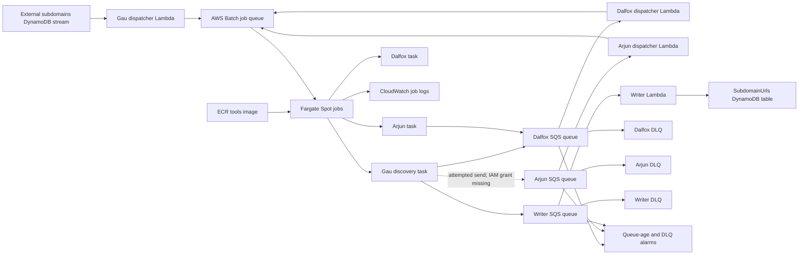

# XHunt — AWS Event-Driven Workload Orchestration

XHunt is an independent reference implementation for coordinating asynchronous, containerized workloads on AWS. Python Lambda dispatchers translate DynamoDB stream records and SQS messages into AWS Batch jobs running on Fargate Spot. SAM/CloudFormation defines the shared infrastructure and dispatcher components.

The original workload is authorized security automation. The transferable engineering focus is event-driven orchestration, container execution, infrastructure automation and operational failure handling.

**Status:** Historical implementation; current end-to-end deployment is unverified. Known credential, deployment and failure-handling issues must be resolved before a new deployment. This project is not presented as production-hardened or currently running.

The system is built around:
- AWS Batch for job scheduling and execution
- Fargate (FARGATE_SPOT) as the compute backend for Batch jobs
- AWS SAM / CloudFormation for provisioning serverless dispatchers and shared infrastructure
- An ECR-hosted tools container image that runs the actual workload commands

## Architecture at a glance

- An externally supplied subdomains DynamoDB stream triggers Gau discovery jobs; the internally provisioned SubdomainUrls table stores discovered URL results.
- Lambda dispatchers (Python) submit AWS Batch jobs in response to events
- SQS queues decouple stages of work and distribute URLs/tasks across job types
- AWS Batch JobDefinitions run the tools container image with command overrides (shell scripts under `./tasks/`)
- CloudWatch Logs capture per-job output via `awslogs` configuration on the Batch JobDefinitions

### Event flow and current limitations

The diagram follows declared resources and inspected code; it is not a deployment verification.

The three queues have redrive policies. Declared DLQs do not compensate for handlers that swallow exceptions. Batch submission is distinct from job completion. The dashed Arjun edge marks an implemented send that currently lacks its IAM grant. Alarm notification delivery and end-to-end recovery are unverified.

| Implemented in source | Remaining validation or improvement |
|---|---|
| Event dispatchers, Batch/Fargate Spot, queues and DLQs | Retry propagation, idempotent submission and completion reconciliation |
| SAM infrastructure, Docker tools image and ECR | Current build/deploy validation and runtime credential injection |
| URL persistence, logs and alarms | Failure-path tests, notification delivery and operational readiness |

Existing deployment scripts contain stale references and require undocumented configuration. Review the source-backed component map and deployment prerequisites before attempting deployment; no deployment command in this repository is claimed as freshly verified.

## What this demonstrates

- Designing an event-driven workflow that triggers batch execution from real event sources (DynamoDB Streams, SQS)
- Submitting AWS Batch jobs programmatically from Lambda using `submit_job` with container command overrides
- Running containerized batch workloads on AWS Batch backed by Fargate Spot
- Building a reusable "tools" container image (Dockerfile) that packages common automation tooling
- Decoupling workflow stages with SQS queues and DLQs for better reliability
- Durable storage patterns using DynamoDB (including conditional writes to avoid overwriting existing items)
- Operational basics: structured logging from dispatchers, job logs in CloudWatch, and timeouts/retry settings in JobDefinitions
- Infrastructure provisioning via AWS SAM / CloudFormation (nested serverless applications under `cloudformation/sam/`)

## Key components in this repo

- `cloudformation/sam/xhunt-serverless/template.yaml`
  - Shared infrastructure: DynamoDB table, SQS queues, ECR repo, AWS Batch compute environment + job queue, IAM roles
  - Nested SAM apps for individual dispatchers and job definitions
- `cloudformation/sam/xhunt-serverless/*_job_dispatcher/`
  - Python Lambda functions that accept events (SQS or DynamoDB Streams) and submit AWS Batch jobs
- `tasks/`
  - Shell entrypoints invoked by Batch jobs via container command overrides (examples: `gau_urls.sh`, `dalfox_single_url.sh`, `arjun_single_url.sh`)
- `Dockerfile`
  - Builds the `xhunt-tools` container image with a set of CLI tools installed and task scripts bundled
- `build-deploy.sh`
  - Builds and pushes the tools image to ECR (`xhunt-tools:latest`)

## Optional notifications

Tracked provider credentials have been retired. Notifications are disabled unless an explicit runtime provider file is supplied. See [notification configuration and offline tests](notify/README.md). Current AWS Batch templates do not provide runtime credential delivery, so this change leaves Batch notifications disabled.

## Notes

This repository is shared as a representative example of platform-oriented system design applied to batch automation workloads. It is not intended to be a polished or production-ready service. The emphasis is on architectural tradeoffs, event-driven job orchestration, and practical considerations when running asynchronous containerized workloads on AWS Batch (Fargate backend).
